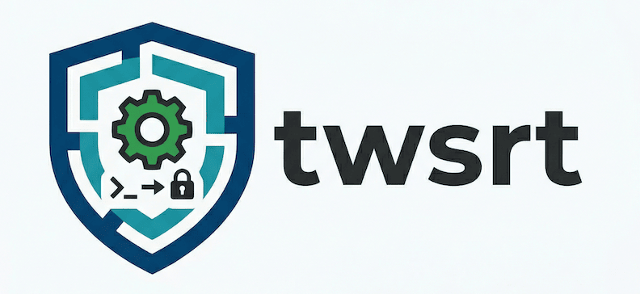
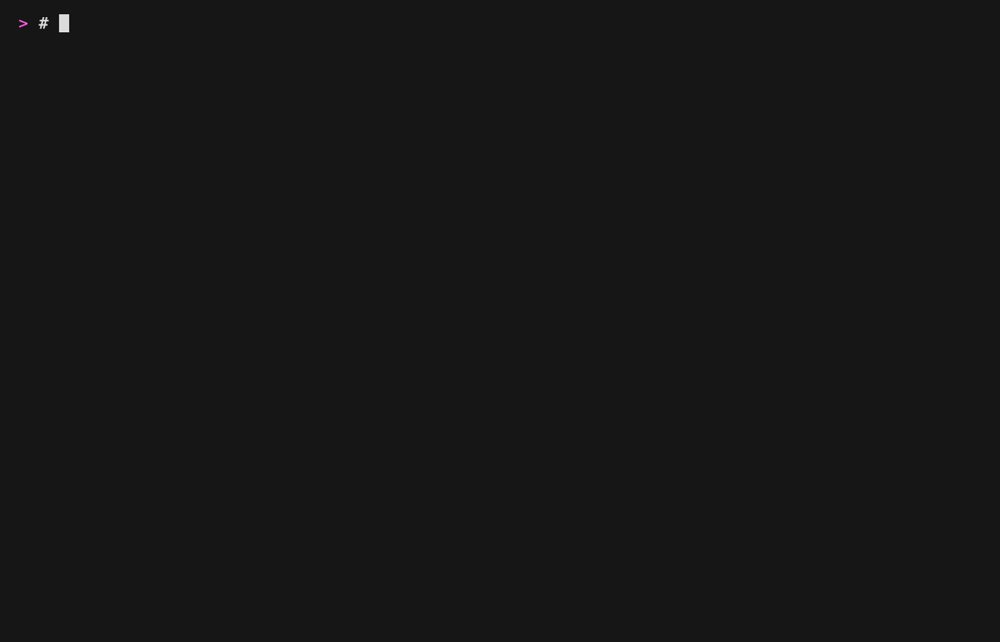

<p align="left">
  
</p>



One security policy, compiled into the native permission and sandbox
configuration of every AI coding agent you run.

1. [Why twsrt](#why-twsrt)
2. [Concepts](#concepts)
3. [Quickstart](#quickstart)
4. [Configuration](#configuration)
5. [Agents](#agents)
6. [Per-project policy](#per-project-policy)
7. [Verifying the policy](#verifying-the-policy)
8. [Security gotchas](#security-gotchas)
9. [Commands](#commands)
10. [Migrating from 3.x](#migrating-from-3x) · [Documentation](#documentation) ·
    [Development](#development)

## Why twsrt

Claude Code, Codex and Copilot each have their own permission model and config
format. Keeping "never read `~/.aws`, never run `sudo`, only reach `github.com`"
in sync by hand drifts and leaves gaps. twsrt keeps the policy once and compiles
it into every agent:

```
                 ┌───────────────────────────┐
   you edit ───► │  policy fragments (JSONC) │   never read ~/.aws · never run sudo
                 │  + profiles (config.toml) │   only reach github.com · ask before git push
                 └─────────────┬─────────────┘
                               │ twsrt generate -w
          ┌──────────────┬─────┴────────┬────────────────┐
          ▼              ▼              ▼                ▼
   ~/.srt-settings   Claude Code      Codex          Copilot CLI + JetBrains
   (srt sandbox)     settings.json    config.toml    settings.json, flags,
                                      + .rules       github-copilot.xml
```

## Concepts

### Compile, then translate

```
 fragments ─(profile)─► compose ─► canonical documents ─► srt-settings.json, bash-rules.json
                                          │
                                          ▼  one in-memory compile feeds every generator
                         Claude · Codex · Copilot · Copilot JetBrains  ─► agent configs
```

| | Canonical documents | Agent configs |
|---|---|---|
| Files | `srt-settings.json`, `bash-rules.json` | Claude `settings.json`, Codex `config.toml` + `.rules`, Copilot `settings.json` + flags, JetBrains `github-copilot.xml` |
| Role | Source of truth; srt's own settings file | Translations into each agent's native model, lossy where an agent lacks a concept (always narrowing, always warned) |
| Depends on | The profile | The canonical documents and the agent |
| Inspect | `twsrt show` | `twsrt generate <agent>` |
| Written by | **every** `generate -w`, whichever agent is named | `generate <agent> -w` |

- Never hand-edit generated files: the next `generate -w` replaces the edit and `twsrt diff`
  reports it. Edit the fragments (`twsrt edit`).
- Nothing is written unless every fragment composes and every selected target renders.

### Two enforcement layers

```
  agent process
  ┌──────────────────────────────────────────────────────────┐
  │  built-in tools: Read · Edit · WebFetch   ◄── layer 2 only │
  │  layer 2: agent permissions (deny / ask / allow)           │
  │        └─► Bash tool ──spawns──┐                           │
  └────────────────────────────────┼───────────────────────────┘
                                   ▼
  ┌──────────────────────────────────────────────────────────┐
  │  layer 1: kernel sandbox (Seatbelt / bubblewrap + proxy) │
  │  every spawned command: deny paths, write allowlist,     │
  │  domain allowlist                                        │
  └──────────────────────────────────────────────────────────┘
```

| Access | Layer 1: kernel sandbox | Layer 2: agent permissions |
|---|---|---|
| `Bash(cat ~/.aws/credentials)` | denied | denied |
| `Read(~/.aws/credentials)` | not covered (in-process) | denied |
| `Bash(curl evil.com)` | blocked by the proxy | denied |
| `WebFetch(evil.com)` | not covered (in-process) | allow check |
| `Bash(git push)` vs `Bash(ls)` | cannot tell them apart | deny / ask per command |

Paths and domains (layer 1) are the durable core and translate with high fidelity
into every agent's native sandbox. Bash command rules (layer 2) are a per-agent
supplement. Rationale: [SECURITY_CONCEPT §3.1](SECURITY_CONCEPT.md#31-defense-in-depth).

### Profiles select fragments

A fragment is one slice of policy; a profile selects fragments and may extend
other profiles. Composition only adds:

```
 profile  │ srt/base  srt/cloud-creds  srt/work  bash/base │ use
 ─────────┼────────────────────────────────────────────────┼─────────────────────────
 default  │    ●             ●                       ●     │ the global files
 work     │    ●             ●            ●          ●     │ extends default
 slim     │    ●                                     ●     │ one repo, via --project
```

- A child cannot change a value its parent set: that is a compile error, so no
  profile silently weakens another.
- One profile is in force at a time for the global files; the last `generate -w` wins.
- To drop a rule, select a profile without that fragment (typically per project).

### Prompting is a launch choice

The policy decides **what** is denied and **what** asks. Who answers an `ask`
is chosen per session with the agent's own flag; no generated file changes
([ADR 0010](doc/adr/0010-no-modes-profiles-select-policy.md)):

| | Fewer prompts, `ask` still asks | Nobody present, `ask` denies |
|---|---|---|
| Claude Code | `--permission-mode auto` | `--permission-mode dontAsk`, or `--settings '{"permissions":{"denyInsteadOfPrompting":true}}'` (keeps auto mode) |
| Copilot CLI | `--allow-all-tools` (deny rules still win) | `-p` or `--autopilot` |
| Codex | `-c approvals_reviewer=auto_review` | `-a never` |

> **Traps.** `codex --yolo` removes the sandbox. `copilot --yolo` also drops the
> path and URL checks. `claude --allow-dangerously-skip-permissions` skips
> nothing by itself; it only makes that mode selectable.

Keep `ask` for commands whose effect leaves the sandbox (remote systems,
published history, new dependencies): files and domains are kernel-enforced
however a command is spelled, Bash rules match command text only.

## Quickstart

```bash
uv tool install twsrt        # or: pip install twsrt

twsrt config --init          # ~/.config/twsrt/config.toml + starter fragments
twsrt edit                   # deny paths, domains, command rules
twsrt config                 # enable agents under [targets]

twsrt show                   # the compiled srt document
twsrt generate claude        # preview; writes nothing
twsrt generate claude -w     # write canonical outputs + ~/.claude/settings.json
twsrt diff                   # exit 0 when every file matches the fragments
twsrt test                   # prove srt enforces the policy (plain terminal)
```

Regenerate on every launch: `c() { twsrt generate -w claude && claude "$@"; }`

## Configuration

Only `config.toml` and the `.jsonc` fragments are edited by hand. Relative paths
resolve from the directory of `config.toml`. Every compile write-denies
`config.toml` and every `[sources]` path, so edit them from a plain terminal: a
sandboxed agent cannot loosen its own policy
([ADR 0008](doc/adr/0008-policy-files-are-write-denied.md)).

```toml
schema_version = 1
default_profile = "default"

[sources.srt]                     # required
output = "~/.srt-settings.json"   # default: srt-settings.json next to config.toml
[sources.srt.fragments.base]
path = "srt/base.jsonc"
[sources.srt.fragments.work]
path = "srt/work.jsonc"

[sources.bash]                    # optional: without it there are no command rules
[sources.bash.fragments.base]
path = "bash/base.jsonc"

[profiles.default]
srt = ["base"]
bash = ["base"]

[profiles.work]
extends = ["default"]
srt = ["work"]

[targets]                         # an agent is configured only when its key is set
claude_settings  = "~/.claude/settings.json"
codex_config     = "~/.codex/config.toml"
codex_rules      = "~/.codex/rules/twsrt.rules"          # optional
copilot_settings = "~/.copilot/settings.json"            # Copilot native sandbox
copilot_output   = "~/.config/twsrt/copilot-flags.txt"   # Copilot flag snippet
copilot_jetbrains_xml = [
  "~/Library/Application Support/JetBrains/IntelliJIdea2026.2/options/github-copilot.xml",
]
```

> **srt reads only `~/.srt-settings.json`.** Without it, srt runs with built-in
> defaults and no `denyRead`. Set `output = "~/.srt-settings.json"`, or launch
> `srt -s <config dir>/srt-settings.json`.

Unknown keys and keys removed in 4.0 are load errors. Unconfigured agents are
skipped with an `Info:` note. All keys: [REFERENCE: Configuration](doc/REFERENCE.md#configuration).

### Fragments

```jsonc
// srt/base.jsonc                                   // bash/base.jsonc
{                                                   {
  "filesystem": {                                     "deny": ["rm", "sudo", "git push --force"],
    "denyRead":  ["~/.aws", "~/.ssh", "~/.gnupg"],    "ask":  ["git push", "git commit"]
    "denyWrite": ["**/.env", "**/*.pem"],           }
    "allowWrite": [".", "/tmp", "~/dev"]
  },
  "network": {
    "allowedDomains": ["github.com", "*.github.com", "pypi.org"]
  }
}
```

| Key | Meaning |
|---|---|
| `denyRead` | Paths no command can read. **Also compiled into `denyWrite`** ([ADR 0001](doc/adr/0001-deny-read-implies-deny-write.md)) |
| `denyWrite` | Paths or globs no command can write, even inside a write root |
| `allowWrite` | The write allowlist: every other write is denied |
| `allowedDomains` / `deniedDomains` | The network allowlist / explicit denies. An empty or unset allowlist allows no domain |
| Bash `deny` | Block the command and its subcommands |
| Bash `ask` | Prompt first; agents without an ask tier get a deny |
| Bash `allow` | Validated, but compiled into no agent (in Codex it would mean "run unsandboxed") |

Other srt keys (`allowUnixSockets`, `ignoreViolations`, …) follow the
[srt schema](https://github.com/anthropic-experimental/sandbox-runtime?tab=readme-ov-file#configuration).
JSONC comments are allowed; trailing commas and duplicate keys are not.

**Composition.** A profile's fragments merge: objects recursively, arrays as a
union (rule lists sorted, so fragment order does not matter), equal scalars
agree. Unequal scalars and one value in opposing lists fail:
`allowWrite`/`denyWrite`, `allowedDomains`/`deniedDomains`, `denyRead`/`allowWrite`,
and any two of Bash `allow`/`ask`/`deny`. There is no "last one wins".
Full rules: [REFERENCE: Compiler model](doc/REFERENCE.md#compiler-model);
complete examples in [example/](example/).

## Agents

| | Claude Code | Codex | Copilot CLI | Copilot in JetBrains |
|---|---|---|---|---|
| twsrt writes | `~/.claude/settings.json` (selective merge) | `~/.codex/config.toml` profile `twsrt` + `.rules` | `settings.json` keys `sandbox`, `allowedUrls`, `deniedUrls`; flag snippet | `sandbox*` options of each `github-copilot.xml` |
| Paths and domains | native sandbox, always on | native sandbox | native sandbox; flags-only mode: run under `srt` | native sandbox |
| Bash `deny` | `Bash(…)` deny | `forbidden` escalation rule | `--deny-tool` flag | — |
| Bash `ask` | `Bash(…)` ask | Codex default, not restated | `--deny-tool` flag (warned) | — |
| Built-in tools | in-process, permission rules only | sandboxed subprocesses | in-process, checked in software | in-process, checked in software |

| Agent | Must know |
|---|---|
| Claude Code | twsrt rewrites only `permissions.deny`/`ask`, its `WebFetch(domain:…)` and `Edit(…)` allows, and srt's `sandbox` keys; hooks, plugins and model survive. File paths become `Read`/`Edit` permission rules, so the edit tools no longer prompt below `allowWrite` ([ADR 0002](doc/adr/0002-claude-file-rules-as-permission-rules.md)). `sandbox.enabled: true` and `allowUnsandboxedCommands: false` are fixed; one session without sandbox: `claude --settings '{"sandbox":{"enabled":false}}'` |
| Codex | A top-level `sandbox_mode` in `config.toml` aborts generation, but in *any other* config layer, or `--sandbox` on the CLI, it silently disables the twsrt profile: run `codex doctor` after changing Codex config. Restart Codex after generating |
| Copilot CLI | Use the native sandbox (`copilot_settings`) **or** flags-only under `srt` (`copilot_output` alone), never both. Path globs are literal in Copilot and mostly dropped (warned). Bash rules exist only as flags: without `copilot_output` they are not enforced (warned). twsrt owns `allowedUrls`/`deniedUrls`; URLs approved inside Copilot are removed on the next `-w` |
| Copilot JetBrains | Close the IDE before `-w`: a running IDE's file is skipped (red warning, exit 0). List each IDE product and version in `copilot_jetbrains_xml`; new versions are not discovered |

`copilot --add-dir` also loads that directory's `.github/skills` and
`.github/agents` as trusted configuration; twsrt never emits it.
Rule-by-rule translation: [REFERENCE: Rule mapping](doc/REFERENCE.md#rule-mapping-per-agent).

## Per-project policy

A repository runs under its own profile, compiled into the repository and loaded
per launch instead of the global files (Claude and srt only):

```
twsrt generate claude -w -p slim --project        (run from the project root)
  → ./.twsrt/slim/srt-settings.json      canonical srt
  → ./.twsrt/slim/bash-rules.json        canonical bash
  → ./.twsrt/slim/claude-settings.json   Claude target, user keys merged in
  stdout: the absolute ./.twsrt/slim directory
```

```bash
claude-p() { local p=$1 d; shift; d=$(twsrt generate claude -w -p "$p" --project) || return
             claude --setting-sources project,local --settings "$d/claude-settings.json" "$@"; }
srt-p()    { local p=$1 d; shift; d=$(twsrt generate claude -w -p "$p" --project) || return
             srt -s "$d/srt-settings.json" "$@"; }
```

- No global file is touched; `./.twsrt` is added to `denyWrite`; a symlinked `./.twsrt` is
  refused.
- `--setting-sources project,local` is essential: Claude unions list settings across scopes,
  so a deny dropped by the profile would return from `~/.claude/settings.json`.

Why it works and how to re-verify after a Claude upgrade:
[REFERENCE](doc/REFERENCE.md#claude-per-project-launch-premise); security properties:
[SECURITY_CONCEPT §5](SECURITY_CONCEPT.md#5-per-project-policy).

## Verifying the policy

```
 fragments ──doctor──► well-formed, no dead weight?         every profile
     │ generate -w
     ▼
 files on disk ──diff──► still match the fragments?          one profile (-p)
     │
     ▼
 kernel sandbox ──test──► srt enforces what the file says?   one profile (-p)
```

| Command | Exit codes | Notes |
|---|---|---|
| `twsrt doctor` | `0` ok, `1` errors | Broken fragments, uncompilable profiles, redundant rules, glob traps. Silence an entry with `// doctor-ignore[: reason]`. [Checks](doc/REFERENCE.md#doctor-checks) |
| `twsrt diff [agent]` | `0` clean, `1` drift, `2` target missing | Unapplied fragment edits and hand edits to generated files |
| `twsrt test` | `0` passed, `1` any `FAIL`/`INVALID`/`ERROR`, `2` setup error | Run from a plain terminal after every srt, agent or OS upgrade |

`diff` and `test` check one profile: pass the `-p` you generated with.

`test` derives one probe per effective srt rule (a one-byte read, an append-open
that writes nothing, a HEAD request) and runs it twice: plainly, then under
`srt`. A deny passes only when the plain run succeeds and the sandboxed run
fails, so a missing file never counts as protected. A green run proves the rules
you wrote are enforced, not that they are the right rules, and covers srt only,
not the agents' native sandboxes. [Sandbox probes](doc/REFERENCE.md#sandbox-probes).

## Security gotchas

| Gotcha | Consequence | Mitigation |
|---|---|---|
| Built-in tools (Read, Edit, WebFetch) run inside the agent | Only the agent's permission engine guards them | Put the highest-value secrets in `denyRead` so commands are kernel-blocked |
| macOS: srt keeps a symlinked deny path unresolved | `denyRead: ["~/.aws"]` blocks nothing when `~/.aws` is a symlink | Deny the real path too; `twsrt test` reports a `(realpath)` `FAIL` |
| srt anchors relative paths and `**/x` at its launch directory | `"**/.env"` protects nothing outside the launch directory | Use `~/` or absolute prefixes for rules that must hold everywhere |
| Codex `sandbox_mode` in another config layer | The twsrt profile is silently ignored | `codex doctor` after changing Codex config |

Threat model, rationale and every known gap: [SECURITY_CONCEPT.md](SECURITY_CONCEPT.md).

## Commands

| Command | Effect |
|---|---|
| `twsrt config [--init]` | Open `config.toml` in `$EDITOR`; `--init` creates it and starter fragments, never overwriting |
| `twsrt edit [srt\|bash] [-p P] [-n]` | Open the fragments in `$EDITOR`, then report canonical drift; `-n` only lists them |
| `twsrt profiles` | Every profile with its parents and resolved fragments |
| `twsrt show [srt\|bash] [-p P]` | Print a compiled canonical document |
| `twsrt generate [agent] [-p P]` | Preview an agent translation (`claude`, `codex`, `copilot`, `copilot-jetbrains`, default `all`) and the files `-w` would write |
| `twsrt generate [agent] [-p P] -w` | Write the canonical outputs and the agent targets |
| `twsrt generate claude -w -p P --project` | Write profile `P` to `./.twsrt/P/` |
| `twsrt diff [agent] [-p P]` | Compare the compiled policy with the files on disk |
| `twsrt test [-p P] [--denyRead …] [-k TEXT] [--json]` | Probe srt for every effective rule |
| `twsrt doctor [--error] [--warn] [--info] [--all]` | Lint every profile and fragment |

Global options before the subcommand: `-c PATH` (config file), `-v` (debug output,
never policy contents). Results go to stdout, notices to stderr.
[REFERENCE: CLI](doc/REFERENCE.md#cli).

## Migrating from 3.x

4.0 removes modes ([ADR 0010](doc/adr/0010-no-modes-profiles-select-policy.md)).
Removed config keys are load errors that name their replacement.

| 3.x | 4.0 |
|---|---|
| `generate --yolo`, `diff --yolo` | A [launch flag](#prompting-is-a-launch-choice), or a profile without the `ask` fragment |
| `claude_settings = "…/settings.full.json"` | `claude_settings = "…/settings.json"` |
| `claude_settings_yolo`, `copilot_output_yolo`, `[claude_sync]`, `[sandbox_overrides.*]` | Delete |
| `./.twsrt/claude-settings[.yolo].json` | `./.twsrt/<profile>/claude-settings.json` |

1. Close running Claude sessions, run `twsrt generate claude -w`. It reads through
   the old `settings.json` symlink, keeping hooks, plugins and model, and replaces
   the link by a regular file. Check with `twsrt diff claude`.
2. Delete `settings.full.json`, `settings.yolo.json`, `copilot-flags.yolo.txt`.
   `ask` rules that yolo dropped now prompt: review them.
3. Delete the 3.x files directly under each `./.twsrt` and point launchers at the
   directory `generate --project -w` prints. Until then `--project` refuses to run.

## Documentation

| Document | Read it for |
|---|---|
| [doc/REFERENCE.md](doc/REFERENCE.md) | Every config key and command, translation tables, merge behaviour, compiler rules, doctor checks, probes |
| [SECURITY_CONCEPT.md](SECURITY_CONCEPT.md) | Threat model, principles, risk analysis, known enforcement gaps |
| [doc/adr/](doc/adr/) | Architecture decision records |
| [pi-extensions/sandbox](https://github.com/sysid/pi-extensions/tree/main/packages/sandbox) | pi-mono integration |

## Development

```bash
make test               # pytest with coverage
make static-analysis    # ruff check, ruff format, ty
make install            # uv tool install -e . plus shell completion
make install-srt        # srt at the pinned SRT_VERSION
make srt-schema-check   # installed srt = SRT_VERSION, doctor's key table matches it
```

After an srt upgrade follow [REFERENCE: After an srt upgrade](doc/REFERENCE.md#after-an-srt-upgrade).
